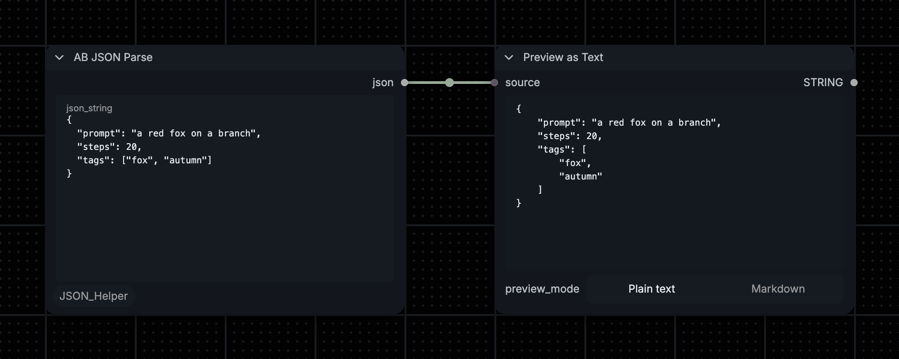

<div align="center">

# AB JSON Parse: JSON strings to JSON objects for ComfyUI

**Turn JSON text into a JSON object that nodes with a JSON input accept.**

<br />

[](https://github.com/a-und-b/ComfyUI_JSON_Helper/stargazers)
&nbsp;
[](https://registry.comfy.org/nodes/json_helper)
&nbsp;
[](https://registry.comfy.org/nodes/json_helper)
&nbsp;
[](LICENSE)

<br />



---

Many nodes put out JSON as plain text, and the nodes that take JSON want an object. AB JSON Parse sits in between: text in, JSON object out.

[Install](#install) · [Example workflow](#example-workflow) · [Usage](#usage) · [Contributing](#contributing)

</div>

---

## Features

| You want | You use |
|----------|---------|
| JSON text from another node as an object | its STRING output into `json_string` |
| A fixed JSON object in the graph | JSON typed into the `json_string` field |

No extra dependencies, no network calls.

## Install

**ComfyUI Manager:** search for **AB JSON Parse**, install, restart ComfyUI.

**comfy-cli:**

```bash
comfy node install json_helper
```

**Manually:**

```bash
cd ComfyUI/custom_nodes/
git clone https://github.com/a-und-b/ComfyUI_JSON_Helper.git
```

Restart ComfyUI. The node appears under **AB/Utils**; search for `AB JSON` or `parse json`.

## Example workflow

[`ab-json-parse-string-to-object.json`](example_workflows/ab-json-parse-string-to-object.json): sample JSON text parsed by **AB JSON Parse** and shown in **Preview as Text**. Drag the file onto the canvas, or open it in ComfyUI under Workflow → Browse Templates, under the pack's name.

## Usage

1. Connect a node that puts out a JSON string to `json_string`, or type JSON into the field.
2. Connect the `json` output to a node that expects JSON.

If the text is not valid JSON, the node prints the parse error to the console and outputs `None`.

## Contributing

Bug reports and pull requests are welcome. Open an [issue](https://github.com/a-und-b/ComfyUI_JSON_Helper/issues) first for larger changes; [`CONTRIBUTING.md`](CONTRIBUTING.md) has the three steps.

## License

[MIT](LICENSE)

---

<div align="center">

Built by [Holger Will](https://github.com/a-und-b) at [anders & besser](https://andersundbesser.de)

<br />

[](https://github.com/a-und-b/ComfyUI_JSON_Helper/stargazers)

</div>
